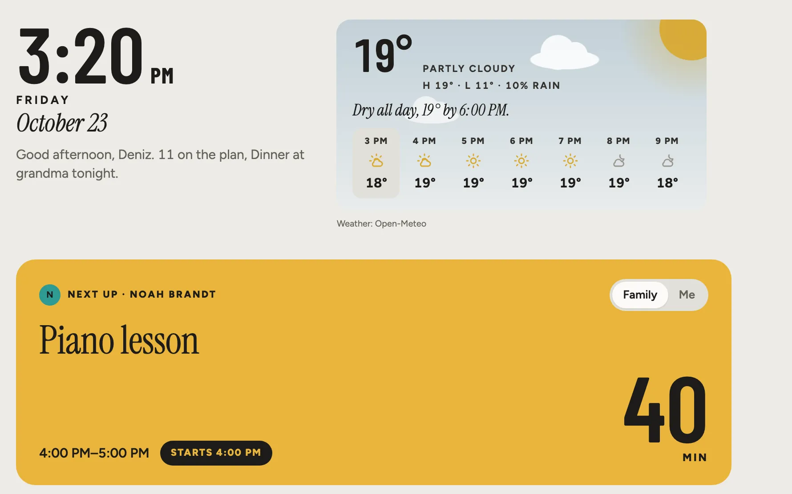
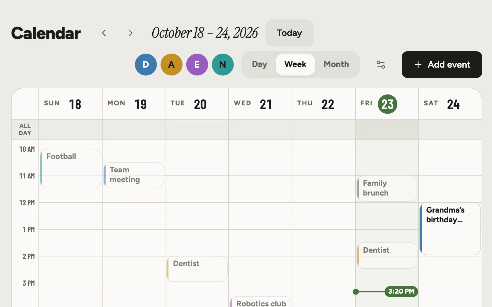
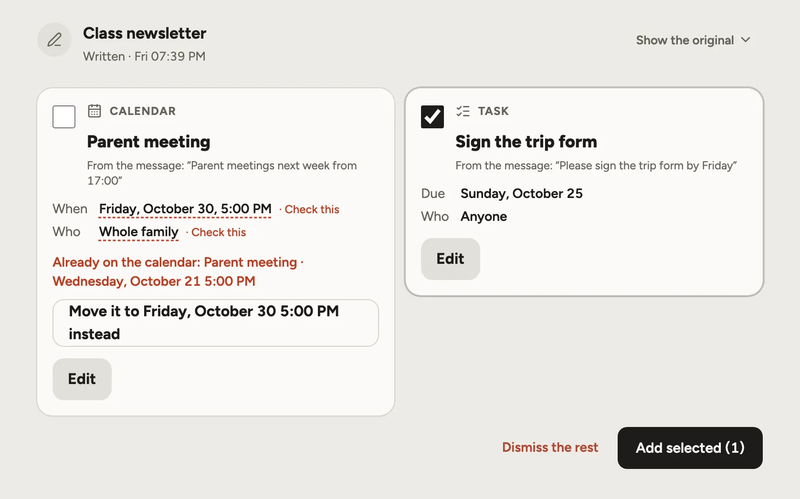
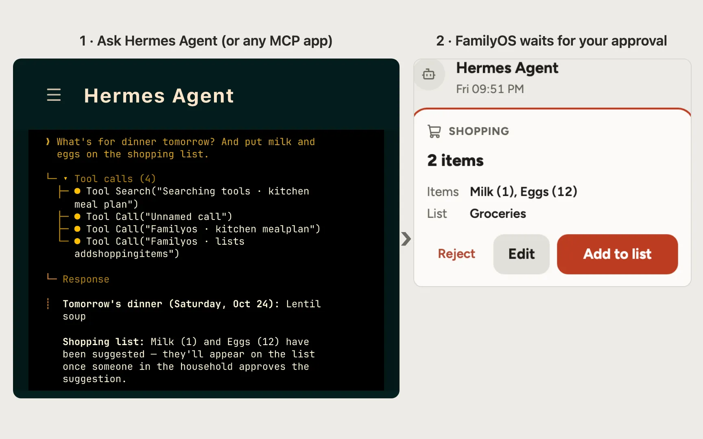
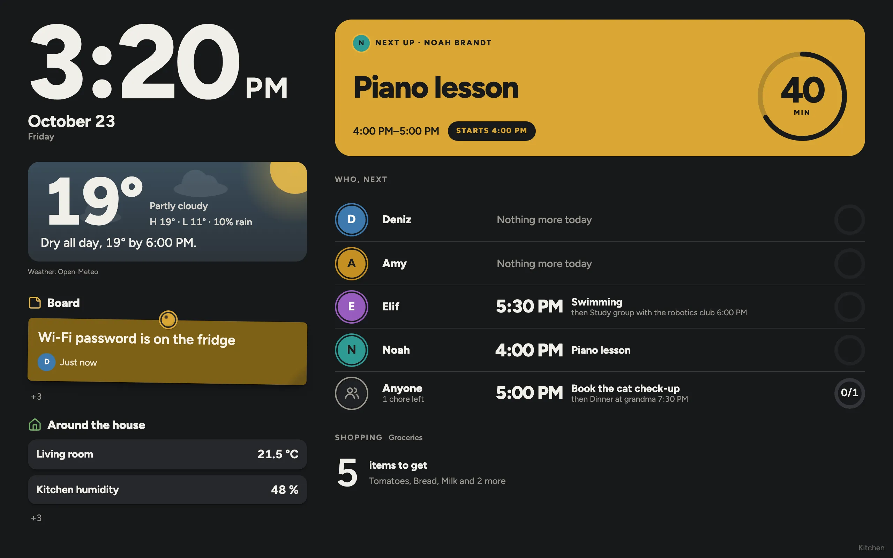
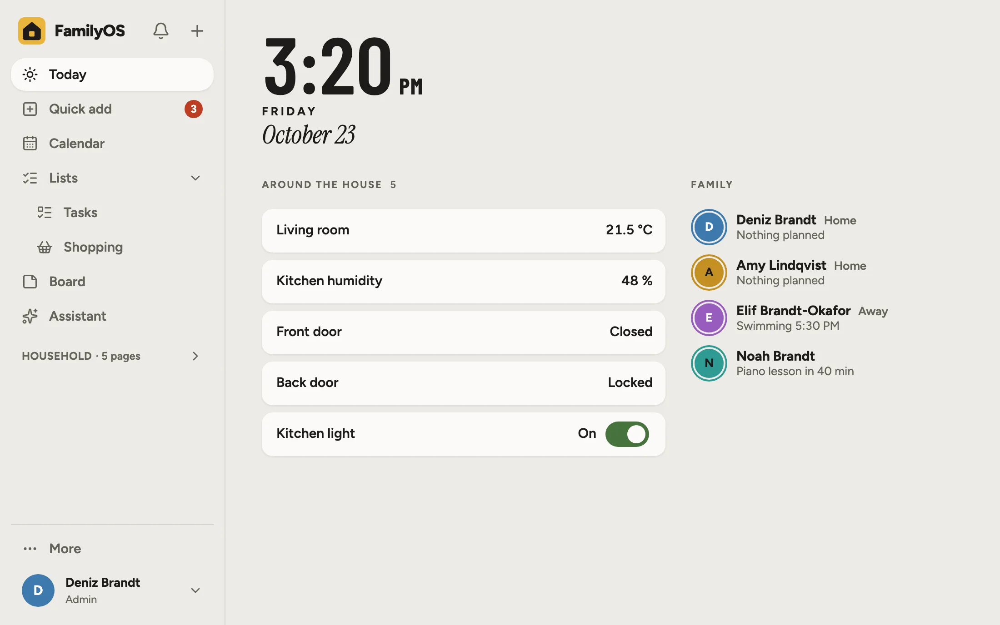
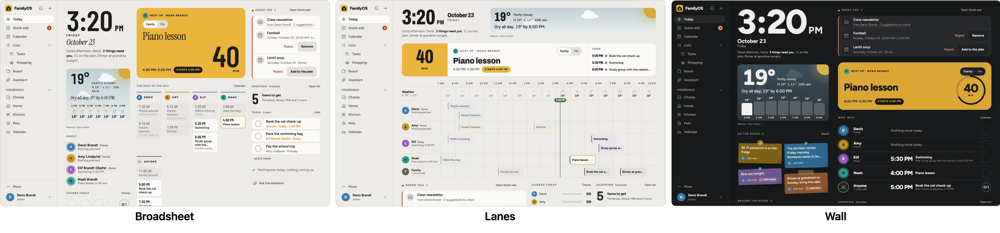

#  FamilyOS

**A self-hosted organizer for families.** One web app for the household's calendar, tasks, shopping,
chores, recipes and paperwork, on your own hardware (a Raspberry Pi is enough). An AI model of your
choice suggests; a person in the family approves.


https://github.com/user-attachments/assets/25be65a8-3f14-42ee-a2e2-a92d369a6ce8

> [!WARNING]
> **Beta.** Until 1.0 there is **no backward-compatibility guarantee**: the data format, the API,
> the MCP tools and the pack formats may change between 0.x versions. Upgrades migrate your data
> automatically; a change that needs a manual step is listed under "Breaking changes" in the
> release notes. **Back up before every upgrade.** There has been no independent security audit:
> keep it off the open internet unless it is behind HTTPS (a VPN such as Tailscale or WireGuard is
> better). Read the [disclaimer](DISCLAIMER.md) and the [security policy](SECURITY.md) first.

## Features

<table>
<tr>
<td width="50%" valign="top">
<br>
<b>Today</b><br>
The next thing, everyone's day, chores and what needs you.
</td>
<td width="50%" valign="top">
<br>
<b>Calendar</b><br>
A shared calendar with a colour per person, repeats and reminders.
</td>
</tr>
<tr>
<td width="50%" valign="top">
<br>
<b>Quick add</b><br>
Share a message, photo or voice note. Tick the suggestions; undo anything.
</td>
<td width="50%" valign="top">
<br>
<b>Your own AI</b><br>
Ask Hermes Agent, Claude or any MCP app about your family. Its changes wait for your approval.
</td>
</tr>
<tr>
<td width="50%" valign="top">
<br>
<b>Family display</b><br>
A wall tablet or an old TV shows the day. It can never change anything.
</td>
<td width="50%" valign="top">
<br>
<b>Home Assistant</b><br>
Sensors and who is home on Today; switch only what you allow.
</td>
</tr>
</table>

**Also:** [lists and shopping](docs/guide/everyday.md), [chores](docs/guide/chores.md),
[kitchen](docs/guide/kitchen.md), [household records](docs/guide/records.md),
[the board](docs/guide/board.md), [the assistant](docs/guide/assistant.md),
[offline use](docs/guide/offline.md), [roles](docs/guide/members.md),
[backups](docs/guide/backups.md), [Telegram](docs/guide/telegram.md), [email](docs/guide/email.md),
[Siri](docs/guide/siri.md), [the API](docs/guide/api.md), [languages](docs/guide/languages.md) and
[themes](docs/guide/appearance.md).



## Quick start (Docker Compose)

```bash
mkdir familyos && cd familyos
curl -fsSLO https://raw.githubusercontent.com/onurceri/family-os/main/docker-compose.yml
docker compose up -d
docker compose logs famos
```

**After it starts, open the address that the last command prints.** It looks like
`http://localhost:3000/setup?code=…` and contains the one-time setup code. If you do not see it
yet, wait a few seconds and run `docker compose logs famos` again.

The image (`ghcr.io/onurceri/familyos`, amd64 and arm64) runs on a Raspberry Pi too. Update with
`docker compose pull && docker compose up -d`; to build from source, run
`docker compose -f docker-compose.yml -f docker-compose.build.yml up -d --build`.

On that page, choose a language and create the first admin account. The setup code is also stored
in the data volume as `setup-code`, so nobody else can claim a fresh instance before you do. Then
add the family under **Settings → Family → Members**. Everything lives in the `famos-data` volume
(`/data`): database, files, backups, packs and a generated secret.

To install FamilyOS as an app on phones and share to it, serve it over **HTTPS** (Tailscale, or
behind Caddy) with `FAMOS_BASE_URL` set to that address. The [user guide](docs/guide/README.md)
covers installation, HTTPS and [configuration](docs/guide/configuration.md).

## Cost and what leaves your home

FamilyOS is free and open source. The project has no paid tier, no hosted service and no telemetry.
It makes an outside connection only when you set one up:

- **Weather:** Open-Meteo gets the name you type when you search for your city, and, while the weather is on,
  your place rounded to about a kilometre.
- **AI:** only to a provider you add, per area, and you can keep areas **Off** or **Local only**
  ([AI and privacy](docs/guide/ai.md)).
- **Extensions:** the signed list is fetched only when you press **Look for more**.
- **Telegram, email, backup targets, calendar subscriptions, Home Assistant:** only the addresses you enter.

Details: [AI and privacy](docs/guide/ai.md), [extensions](docs/guide/extensions.md),
[security policy](SECURITY.md).

## Supported browsers

Chrome, Edge and Android WebView 106 or newer, Safari and iOS 16.4 or newer, Firefox 114 or newer.
A wall display can be an older device, such as an Android photo frame or a fridge screen, as long
as its browser is Chrome 106 or newer.

## Roadmap

- [x] Extensions are isolated from each other: each one reaches only its own data, files and secrets
- [x] Install and remove extensions from Settings (official, signed packages); pets, vehicles, home,
      kitchen and photos & weather become optional
- [x] AI apps sign in with OAuth instead of a pasted key, for the person who approves them
- **Home Assistant**
  - [x] Sensors and who is home on Today and the wall display, and switching the devices you choose
  - [x] FamilyOS notifications in the Home Assistant app
  - [x] [Integration](https://github.com/onurceri/familyos-homeassistant) (HACS custom repository): the
        family calendar, shopping lists, tasks and chores as entities, and a waiting-for-approval sensor
  - [x] Actions from your automations: add to a list, tick off a chore, post a note on the board
  - [x] Assist talks to FamilyOS as your own AI app, over OAuth
  - [ ] The integration in HACS's default list
- [ ] Extensions from other authors, with your explicit consent
- [ ] 1.0: a stable data format and API, with a backward-compatibility promise

## Documentation

- [User guide](docs/guide/README.md): installation, everyday use, backups, AI and privacy, MCP,
  [configuration](docs/guide/configuration.md) and more
- [Contributing](CONTRIBUTING.md) and [AGENTS.md](AGENTS.md): development and the rules CI enforces
- [Architecture](docs/architecture.md) · [Design system](docs/design/design-system.md) ·
  [Releasing](docs/releasing.md)
- [Security policy](SECURITY.md) · [Disclaimer](DISCLAIMER.md) · [Changelog](CHANGELOG.md)

## License

[GNU AGPL v3.0 or later](LICENSE). You may self-host, modify and share FamilyOS; if you run a
modified version for others over a network, you must offer them its source code.
